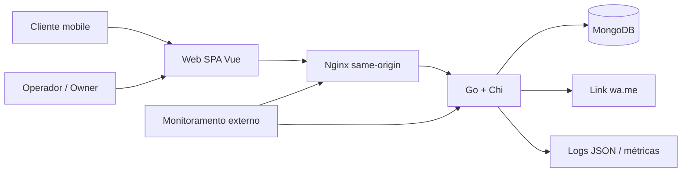
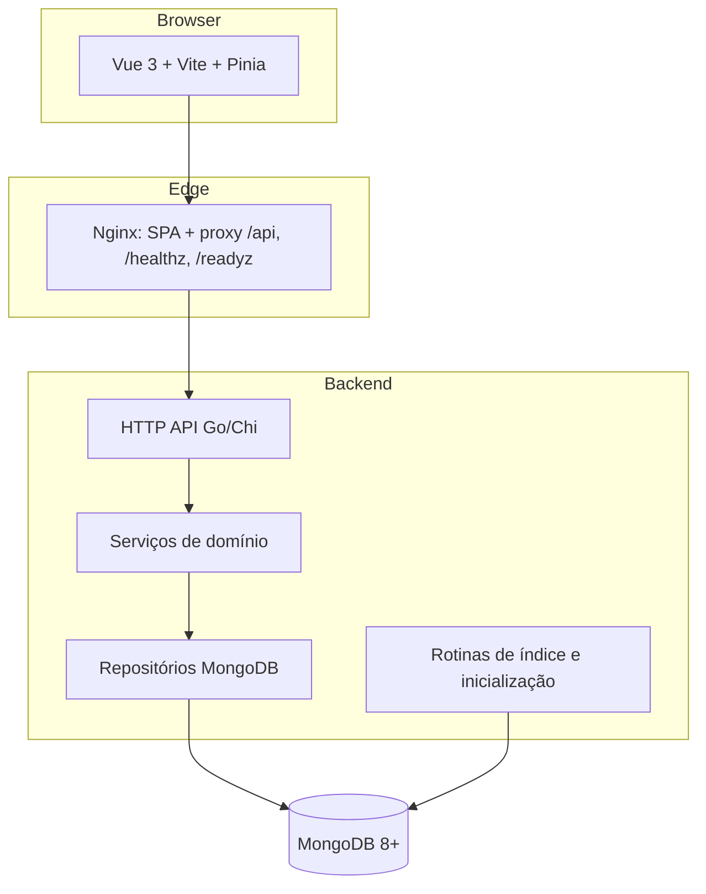
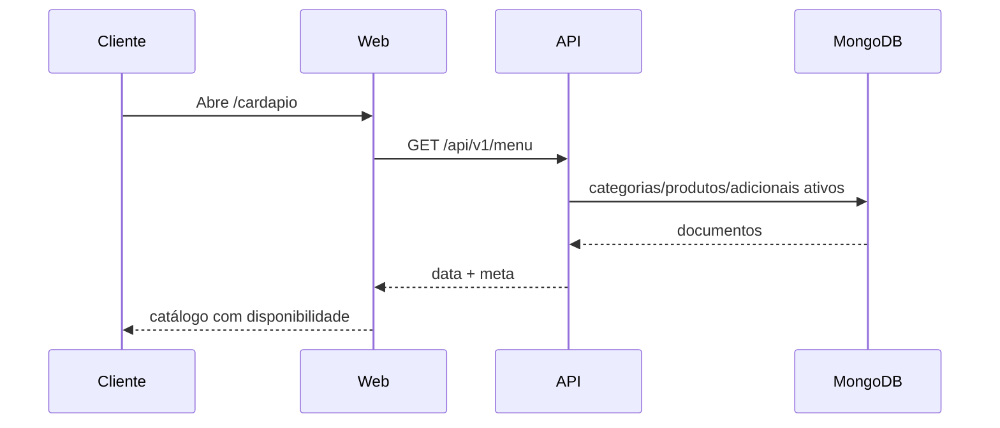
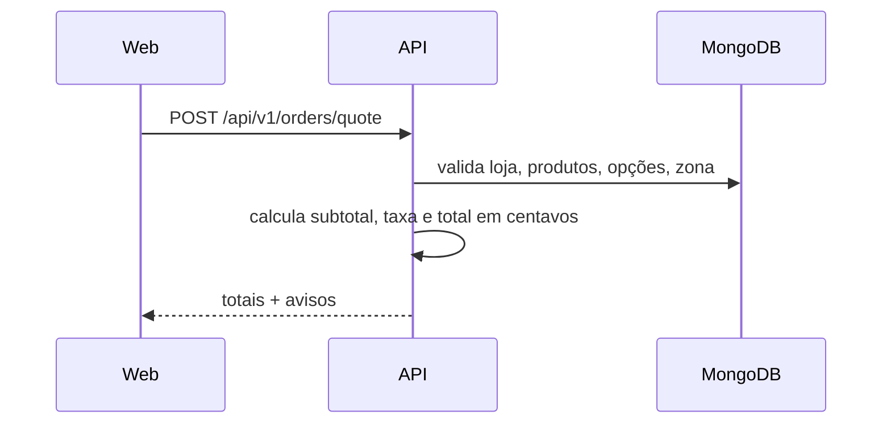
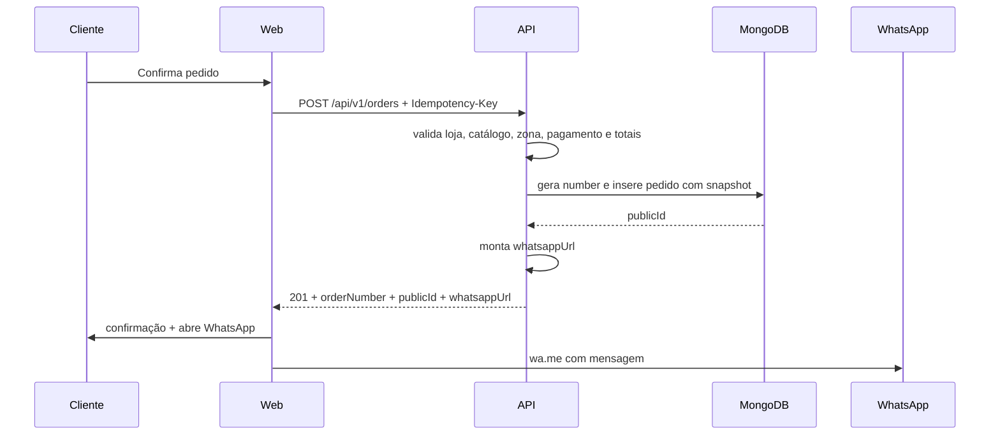
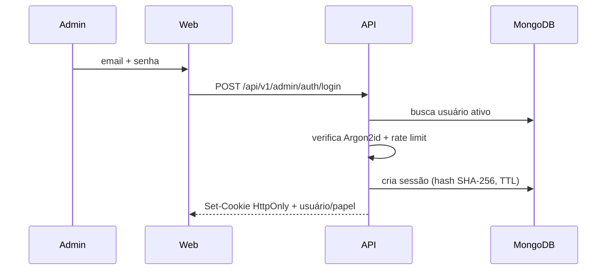
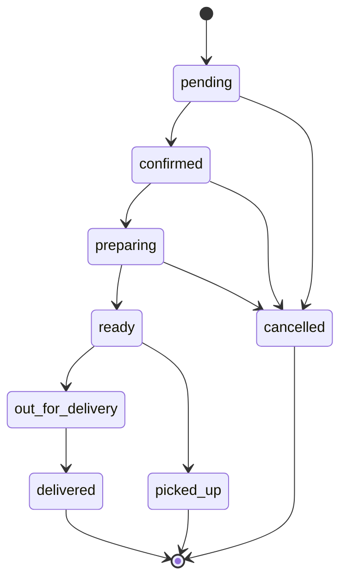
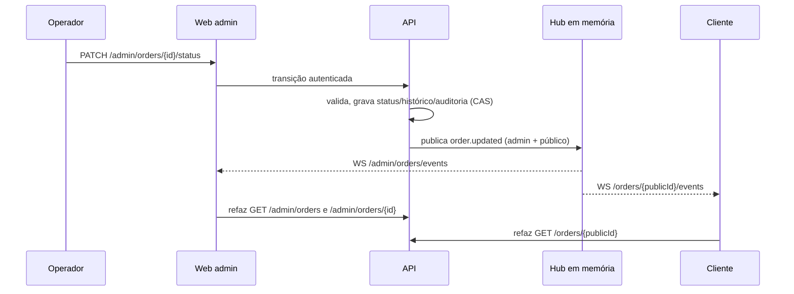

# Arquitetura — Brocados Lanches

**Versão:** 1.0  
**Atualizado em:** 18/11/2026  
**Status:** arquitetura da V1 planejada; implementação incremental.  
**Relacionados:** `03-prd.md`, `05-modelo-de-dados.md`, `06-contrato-api.md`, `09-qualidade-e-testes.md`, `adr/`.

---

## 1. Princípios

1. **Servidor autoritativo:** preço, adicional, taxa, total, disponibilidade e status da loja são calculados no backend.
2. **Pedido persistido antes do handoff:** o WhatsApp é consequência do pedido, não o local onde ele nasce.
3. **Same-origin:** web e API atrás do mesmo domínio e proxy reverso.
4. **Simplicidade operacional:** uma loja, um MongoDB, um processo de API; sem microserviços na V1.
5. **Segurança por padrão:** admin autenticado, cookie `HttpOnly`, CSRF, rate limit e logs sem PII.
6. **Dinheiro inteiro:** centavos em `int64`; nenhum `float` em regra de negócio.
7. **Tempo explícito:** persistência UTC; apresentação em `America/Fortaleza`.
8. **Design system como contrato:** UI usa tokens e componentes aprovados; sem CDN.
9. **Testabilidade:** camadas isoladas, testes de tabela, `httptest`, testcontainers e E2E.
10. **Evolução sem quebra:** contrato versionado em `/api/v1`; mudança incompatível exige `/api/v2`.

---

## 2. Contexto do sistema



**Fora do contexto da V1:** gateway de pagamento, WhatsApp Business API, PDV, KDS, impressora, app nativo e delivery tracking.

---

## 3. Containers



| Container | Responsabilidade | Não faz |
|---|---|---|
| Web | SPA, rotas, estado de UI, chamadas à API | Não calcula preço final, não acessa Mongo |
| Nginx | Servir `dist`, proxy same-origin, headers, fallback SPA | Não contém regra de negócio |
| API | Validar, calcular, persistir, autenticar, auditar | Não renderiza HTML do cliente |
| MongoDB | Persistência, índices, TTL de sessão | Não é exposto publicamente em produção |

---

## 4. Backend

### 4.1 Organização planejada

```text
backend/
├── cmd/api/                  # composição, config, shutdown
├── internal/
│   ├── config/               # env e validação
│   ├── httpapi/              # router, middleware, handlers, respostas
│   │   ├── public/           # store, menu, zones, orders, quote
│   │   └── admin/            # auth, catálogo, zonas, loja, pedidos, usuários, auditoria
│   ├── domain/               # entidades, enums, erros sentinela, regras puras
│   ├── service/              # casos de uso e transações
│   ├── repository/           # MongoDB, índices, mapeamento de erro
│   └── platform/             # clock, IDs, hash, log, WhatsApp, validação
├── scripts/                  # migrações e utilitários versionados
└── vendor/                   # dependências para build offline
```

### 4.2 Camadas

```text
handler → service → repository → MongoDB
             ↓
           domain
```

- **handler:** lê JSON, valida forma, chama service, mapeia erro para HTTP; não calcula preço.
- **service:** regra de negócio, autorização contextual, orquestração, idempotência.
- **repository:** queries, índices, tradução de erro do Mongo para erro de domínio.
- **domain:** entidades, enums, erros sentinela e funções puras de cálculo.
- **platform:** clock, geração de IDs, hash de senha/token, log, link WhatsApp.

Proibido:

- `service` importar `net/http` ou `chi`;
- `handler` acessar MongoDB;
- estado global mutável;
- `init()` com efeito colateral;
- regra de preço no handler ou no frontend.

### 4.3 Injeção de dependência

`cmd/api/main.go` monta o grafo:

```text
config → logger → mongo client → repositories → services → handlers → router → server
```

O desligamento é gracioso: parar de aceitar conexões, aguardar requisições em andamento, desconectar Mongo, registrar evento.

### 4.4 Middleware

Ordem prevista:

1. recuperação de panic;
2. request ID;
3. log estruturado;
4. headers de segurança;
5. limite de corpo;
6. rate limit por rota;
7. autenticação admin (quando aplicável);
8. autorização por papel;
9. handler.

O request ID entra na resposta e no log. Nenhum middleware loga corpo, cookie, authorization, nome, telefone ou endereço.

### 4.5 Configuração

- Toda variável é lida e validada no start.
- Produção falha rápido se faltar configuração obrigatória.
- Segredos nunca ficam no repositório.
- `APP_ENV` controla cookies `Secure`, CORS e nível de log.
- Timezone da operação é carregado de `time.LoadLocation("America/Fortaleza")`.

---

## 5. Frontend

### 5.1 Organização planejada

```text
frontend/src/
├── components/               # BaseButton, ProductCard, QuantityStepper, PriceText, etc.
├── composables/              # useStoreStatus, useFormatMoney, useAsyncState
├── features/
│   ├── catalog/              # cardápio, busca, produto
│   ├── cart/                 # carrinho e persistência
│   ├── checkout/             # formulário e cotação
│   ├── orders/               # confirmação e acompanhamento
│   └── admin/                # auth, catálogo, pedidos, loja
├── router/                   # rotas públicas e admin lazy
├── services/                 # http.ts e endpoints tipados
├── stores/                   # Pinia setup
├── types/                    # tipos compartilhados
├── views/                    # páginas
└── styles/                   # Tailwind + tokens
```

### 5.2 Rotas

Públicas:

- `/`
- `/cardapio`
- `/produto/:slug`
- `/carrinho`
- `/checkout`
- `/pedido/:publicId`
- `/contato`
- `/privacidade`
- `/creditos`

Admin (lazy):

- `/admin/login`
- `/admin`
- `/admin/produtos`
- `/admin/categorias`
- `/admin/adicionais`
- `/admin/locais`
- `/admin/pedidos`
- `/admin/pedidos/:id`
- `/admin/loja`
- `/admin/usuarios` (owner)
- `/admin/auditoria` (owner)
- `/admin/conta`

### 5.3 Estado

| Store | Estado | Persistência |
|---|---|---|
| `useMenuStore` | catálogo, status, zonas | cache em memória; revalidação |
| `useCartStore` | itens, quantidades, opções | `localStorage` apenas IDs/quantidades/escolhas |
| `useCheckoutStore` | fulfillment, zona, endereço, pagamento, cotação | memória; não persistir PII |
| `useOrderStore` | pedido criado, acompanhamento | memória; link público |
| `useAdminAuthStore` | sessão, usuário, papel | cookie do servidor; não token em JS |
| `useAdminOrdersStore` | fila, filtros, paginação | memória |

O carrinho guarda uma versão de schema. Se a versão mudar, migra ou limpa com aviso. O carrinho nunca guarda preço confiável nem total.

### 5.4 Cliente HTTP

- Um único `src/services/http.ts`.
- `credentials: 'include'`, timeout, `Accept: application/json`.
- Erro de API vira `ApiError` com `status`, `code` e mensagem em português.
- Componentes não chamam `fetch` diretamente.
- Toda tela trata carregando, vazio, erro e sucesso.
- Nunca mostrar JSON cru ou stack trace.

### 5.5 Guard de rota

O guard consulta `GET /api/v1/admin/auth/me` através da store `useAdminAuthStore` (uma vez por carregamento, com recarga explícita). Sem sessão (`401`), redireciona para `/admin/login` mantendo o destino em `?redirect=`. Se a rota exigir papel que o usuário não possui, redireciona para `/admin/sem-acesso` (`403`). O cliente HTTP usa `credentials: 'include'`; no desenvolvimento o proxy do Vite alinha `Origin` ao `Host` repassado à API para que a proteção CSRF não bloqueie requisições locais. O guard é conveniência de UX; a autorização real é sempre no servidor.

---

## 6. Fluxos

### 6.1 Carregar cardápio



O frontend não recalcula preço; apenas formata o valor recebido. A disponibilidade é a do momento da leitura.

### 6.2 Cotação



A cotação não persiste pedido e não recebe dados pessoais. Se a loja fechar entre a cotação e o envio, o `POST /orders` rejeita.

### 6.3 Criar pedido e handoff



Se a inserção falhar, nada é enviado. Se o WhatsApp falhar, o pedido permanece e a tela oferece reenvio.

### 6.4 Login admin



O token de sessão nunca é exposto ao JavaScript. Logout apaga a sessão. Login rotaciona a sessão.

### 6.5 Transição de status



`ready → out_for_delivery` só para `delivery`; `ready → picked_up` só para `pickup`. Toda transição inválida retorna `409`.

### 6.6 Atualização em tempo real



O hub (`internal/realtime`) distribui sinais mínimos — identificador opaco, número, status e timestamp — sem PII, valores ou link do WhatsApp. Os handlers `POST /orders` e `PATCH /admin/orders/{id}/status` publicam depois da gravação confirmada; uma falha de publicação não desfaz o pedido. O canal administrativo exige a sessão em cookie; o público é identificado apenas pelo `publicId`.

As assinaturas vivem na memória do processo. Em uma implantação com mais de uma réplica da API, o hub precisa ser substituído por um barramento compartilhado (ou as réplicas precisam de afinidade) para que operadores conectados a instâncias diferentes recebam os mesmos sinais. As telas reconectam com backoff e continuam funcionando com o carregamento inicial via HTTP se o WebSocket estiver indisponível.

### 6.7 Webhook de notificações

Além do WebSocket, os mesmos handlers pós-persistência acionam um notificador HTTP externo (`internal/platform/webhook`). A configuração fica em `store_settings.webhook` e é administrada por `owner` em `/admin/integrations/webhook`. O disparo é genérico: `order.created` na criação e `order.updated` em qualquer transição persistida, sem lista fixa de status e sem duplicação em replay de idempotência.

O notificador lê configuração e `whatsapp` da loja em uma única consulta ao documento único, monta `{number, storeNumber, message}` com o snapshot congelado do pedido e envia um único POST com timeout de 3 s, sem retry e sem fila persistida (D-046). Se o número da loja estiver ausente, o envio é ignorado com aviso sem PII. Redirecionamentos não são seguidos para que um `307/308` não repita o corpo com PII em destino não configurado. A chamada roda em goroutine com contexto desvinculado da requisição: indisponibilidade do destino, resposta de erro ou URL inválida nunca alteram o pedido gravado. Logs registram só categoria do erro, status HTTP e tipo do evento — nunca URL completa, corpo, telefone, nome ou endereço. Respostas 3xx também são registradas como falha, pois o redirecionamento não é seguido.

Os dois PATCH do documento único são disjuntos: a configuração operacional da loja atualiza apenas os campos da loja e o PATCH owner-only atualiza somente `webhook`. Assim, uma leitura obsoleta em uma tela não restaura a configuração da outra.

Diferente do WebSocket, o webhook é um canal externo e carrega PII no corpo; por isso a URL não é devolvida a `operator`, não entra em auditoria e o usuário aceitou explicitamente o risco de SSRF e de envio a terceiros (D-042).

---

## 7. Cálculo de preço e disponibilidade

### 7.1 Entrada

O cliente envia apenas:

- `productId`, `quantity`, `optionIds`, `note`;
- `fulfillment`, `zoneId`;
- dados pessoais e endereço;
- pagamento e troco.

Nunca envia preço, taxa, total, status ou disponibilidade.

### 7.2 Algoritmo

1. Validar loja aberta (horário + kill switch).
2. Carregar produtos ativos e disponíveis.
3. Validar quantidade e opções obrigatórias/mínimo/máximo.
4. Validar adicionais vinculados e ativos.
5. Somar `unitPriceCents` + opções + adicionais por item.
6. Multiplicar pela quantidade e somar `lineTotalCents`.
7. Se delivery: validar zona ativa e somar `feeCents`.
8. Se pickup: taxa zero.
9. Validar troco (`changeForCents >= totalCents` quando dinheiro).
10. Congelar nomes, preços e taxas no pedido.
11. Persistir e responder.

### 7.3 Arredondamento

- Todos os valores são inteiros em centavos.
- Nenhuma divisão ou percentual na V1.
- Se no futuro houver desconto percentual, usar pontos-base inteiros e arredondamento documentado.

### 7.4 Status da loja

```
aberta = horárioPermite(now no fuso) && store.isOpen
```

- `isOpen` é o kill switch manual.
- Horários com mais de um intervalo por dia são suportados.
- Horário que cruza meia-noite é suportado.
- Feriados e exceções entram como P2; se necessários, modelar `exceptions[]`.
- O status é calculado no servidor e devolvido em `GET /store`.

---

## 8. Idempotência e identificadores

### 8.1 Idempotência

- `Idempotency-Key` obrigatório em `POST /orders`.
- Chave de 16 a 128 caracteres; recomendado UUID v4.
- Índice único sparse em `orders.idempotencyKey`.
- Guardar `requestHash` (SHA-256 do corpo canônico) para detectar reutilização com corpo diferente.
- Mesma chave + mesmo hash: devolver o mesmo pedido, sem duplicar.
- Mesma chave + hash diferente: `409 CONFLICT`.
- A chave é entrada do cliente; não registrar em claro no log.

### 8.2 `publicId`

- 16 bytes aleatórios, base64url (128 bits).
- Não sequencial, não derivado do `number`.
- Usado no acompanhamento público.
- Colisão: gerar novamente; índice único garante.

### 8.3 `number`

- Sequencial por contador `counters`.
- `findOneAndUpdate` com `$inc` é atômico.
- Se a inserção falhar depois do incremento, o número é consumido e gera lacuna; isso é aceitável e documentado.
- Não usar `number` para acesso público.

> A V1 não exige transação de réplica para pedido + contador. Se o ambiente usar replica set, a transação pode ser avaliada; não é pré-requisito.

---

## 9. Erros e HTTP

- Erros de domínio são sentinelas/tipos comparáveis com `errors.Is`/`errors.As`.
- Mapeamento centralizado em `httpapi`.
- Resposta pública genérica para 5xx; detalhe apenas no log.
- Códigos estáveis: `VALIDATION_ERROR`, `UNAUTHORIZED`, `FORBIDDEN`, `NOT_FOUND`, `CONFLICT`, `STORE_CLOSED`, `ZONE_UNAVAILABLE`, `PRODUCT_UNAVAILABLE`, `RATE_LIMITED`, `INTERNAL_ERROR`.
- `429` não revela se conta existe.
- `409` para transição inválida e idempotência conflitante.

Detalhes em `06-contrato-api.md`.

---

## 10. Segurança

### 10.1 Sessão admin

- Senha com Argon2id; mínimo 12 caracteres.
- Token aleatório de 32 bytes; hash SHA-256 no MongoDB.
- Cookie `HttpOnly`, `Secure` em produção, `SameSite=Lax`, `Path=/`; prefixo `__Host-` em produção.
- Expiração ociosa de 8 h; absoluta de 7 dias.
- Rotação no login; logout apaga.
- Rate limit de login por IP + e-mail.

### 10.2 CSRF e CORS

- Same-origin por padrão.
- Métodos mutáveis validam `Origin`/`Referer`.
- Se o deploy deixar de ser same-origin, implementar token double-submit.
- CORS allowlist explícita apenas em desenvolvimento.

### 10.3 Headers

No proxy reverso:

- CSP compatível com o build;
- `X-Content-Type-Options: nosniff`;
- `Referrer-Policy`;
- `Permissions-Policy`;
- HSTS em produção.

### 10.4 PII

Nunca logar:

- `name`, `phone`, `address`, `note`;
- `Cookie`, `Authorization`;
- corpo de checkout/login;
- URL do WhatsApp com mensagem.

O log de pedido usa `orderNumber`/`publicId` e metadados técnicos, nunca o conteúdo pessoal.

### 10.5 Rate limit

- Login: 5/min por IP + e-mail.
- Criação de pedido: 10/min por IP e 3/min por telefone.
- Cotação: 30/min por IP.
- Acompanhamento público: 60/min por IP.
- Admin: limite por sessão/rota.

---

## 11. Observabilidade

| Sinal | Implementação | Retenção |
|---|---|---|
| Logs | JSON via `log/slog`, request ID, rota, status, duração, erro técnico | 30 dias |
| Health | `/healthz` (vivo), `/readyz` (ping Mongo) | tempo real |
| Métricas | requisições, erros, latência, pedidos criados, falhas de handoff | 30 dias |
| Alertas | 5xx, readiness, fila parada, falha de backup | imediato |
| Auditoria | mutações admin | 12 meses |

Nenhum log contém PII ou token. O `publicId` é opaco e pode ser usado para correlação.

---

## 12. Deploy e ambientes

| Ambiente | Banco | Uso |
|---|---|---|
| Local | `brocados_dev` | desenvolvimento |
| Teste | `brocados_test` | testes de integração |
| Preview | banco isolado | PR/deploy de validação |
| Produção | `brocados` | operação real |

Topologia de produção:

```text
Internet → TLS → Nginx → SPA + /api → Go API → MongoDB
```

- API e web same-origin, inclusive para o upgrade WebSocket (`/api/v1/.../events`); o proxy precisa repassar `Upgrade`/`Connection`.
- MongoDB não exposto publicamente.
- Build da web sem CDN; fontes self-hosted.
- Build da API com `vendor/`, sem rede.
- Índices criados de forma idempotente no start.
- Shutdown gracioso.
- Backup diário e restauração testada.

O provedor de CI está definido: GitHub Actions (D-016). Hospedagem, domínio e MongoDB de produção seguem como decisão pendente (D-015); o cenário abaixo é uma proposta mapeada, não uma decisão aprovada. Ver `13-decisoes-e-pendencias.md`.

### 4.1 Proposta de deploy no Render (container único)

A proposta de deploy segue a estratégia do `restaurante-canto-verde`: **um único container** no Render. O `Dockerfile` raiz faz build do backend Go com `backend/vendor` e do frontend Vue, depois monta um runtime com nginx + Go. O entrypoint renderiza o template do nginx, sobe a API em `127.0.0.1:${API_PORT}` e mantém o nginx em foreground escutando `${PORT}`.

O `render.yaml` define um único web service `brocados-lanches` (`dockerfilePath: ./Dockerfile`, `healthCheckPath: /healthz`, `plan: free`). O nginx serve a SPA, faz proxy de `/api/`, `/healthz` e `/readyz` para a API local e preserva `X-Forwarded-Proto` para o CSRF aceitar login HTTPS.

Segredos: `MONGODB_URI` (MongoDB Atlas; `MONGO_URI` também é aceito) e `ADMIN_BOOTSTRAP_*` no primeiro deploy. O Atlas precisa permitir conexão do Render. Remova `ADMIN_BOOTSTRAP_*` após criar o primeiro `owner`.

---

## 13. Desempenho e escala

- Catálogo cabe em memória de curto prazo; cache HTTP curto no `GET /menu`.
- Índices cobrem filtros de pedidos e catálogo.
- Paginação máxima de 100.
- Evitar `find` sem limite em coleções que crescem.
- Evitar arrays ilimitados em documentos.
- Compressão no proxy (`gzip`/`brotli`).
- Imagens em WebP/AVIF, com dimensões e lazy loading.
- Fontes self-hosted, `font-display: swap` e preload das principais.
- Orçamento de performance em `09-qualidade-e-testes.md`.

---

## 14. Decisões e pendências

Decisões registradas:

- `adr/0001-stack-e-monorepo.md`
- `adr/0002-persistencia-do-pedido-e-handoff-whatsapp.md`
- `adr/0003-dinheiro-e-fuso.md`
- `adr/0004-autenticacao-admin.md`
- `adr/0005-design-system-e-ui.md`
- `adr/0006-cotacao-server-side.md`

Pendências que afetam arquitetura:

- provedor de hospedagem e CI;
- MongoDB gerenciado ou container;
- WhatsApp link ou API oficial;
- MFA antes ou depois do lançamento;
- política de retenção e anonimização;
- necessidade de cache distribuído (não prevista na V1).
