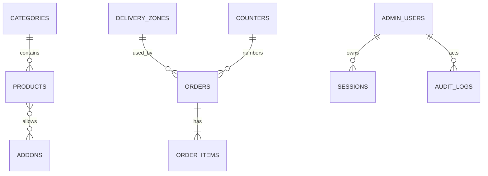

# Modelo de Dados — Brocados Lanches

**Versão:** 1.0  
**Atualizado em:** 20/11/2026  
**Banco:** MongoDB 8+  
**Bancos:** `brocados_dev`, `brocados_test`, `brocados` (produção)  
**Relacionados:** `04-arquitetura.md`, `06-contrato-api.md`, `09-qualidade-e-testes.md`.

---

## 1. Convenções

- Coleções em plural `snake_case`.
- Campos em `camelCase`.
- `_id` é `ObjectID`, exceto `store_settings` (`_id: "main"`) e `counters`.
- A API expõe `id` como string hexadecimal; nunca devolve `_id`.
- Datas em BSON `datetime` UTC; API em RFC 3339 UTC.
- Dinheiro em `int64` centavos, com sufixo `Cents`.
- Percentuais, se existirem, em pontos-base inteiros.
- Todo documento mutável tem `createdAt` e `updatedAt`.
- Documentos criados por seed de desenvolvimento carregam `seed.fictitious: true` e `seed.source`.
- Documentos de catálogo não são apagados fisicamente; usam `active: false`.
- Campos de PII existem apenas em `orders` e `admin_users`.
- Não usar arrays ilimitados dentro de documentos.

---

## 2. Visão geral



As relações são conceituais; o MongoDB guarda o snapshot do pedido, não depende de `lookup` para renderizar histórico.

---

## 3. Coleções

### 3.1 `store_settings`

Documento único `_id: "main"`.

| Campo | Tipo | Obrigatório | Observação |
|---|---|---|---|
| `_id` | string | sim | Sempre `"main"` |
| `name` | string | sim | Nome exibido |
| `isOpen` | bool | sim | Kill switch manual |
| `openingHours` | array | sim | Até 7 dias; intervalos por dia |
| `deliveryTime` | string | sim | Ex.: `30-90 min`; validar com cliente |
| `whatsapp` | string | sim | E.164, sem máscara, ex.: `+5585992358708` |
| `instagram` | string | não | Handle ou URL |
| `address` | string | sim | Endereço completo |
| `createdAt` | datetime | sim | UTC |
| `updatedAt` | datetime | sim | UTC |

`openingHours[]`:

```json
{
  "day": "monday",
  "closed": false,
  "intervals": [
    { "open": "18:00", "close": "23:30" }
  ]
}
```

Regras:

- `day` em inglês (`sunday`…`saturday`), consistente com o banco.
- `closed: true` ignora intervalos.
- `close` pode ser menor que `open` para virada de meia-noite.
- A avaliação usa `America/Fortaleza`.
- Feriados e exceções não fazem parte da V1; se entrarem, usar `exceptions[]` com data e intervalos.

### 3.2 `categories`

| Campo | Tipo | Obrigatório | Observação |
|---|---|---|---|
| `_id` | ObjectID | sim | |
| `name` | string | sim | Exibição |
| `slug` | string | sim | Único, URL-safe |
| `description` | string | não | Texto curto |
| `sortOrder` | int | sim | Ordem crescente |
| `active` | bool | sim | Inativa não aparece |
| `createdAt` | datetime | sim | |
| `updatedAt` | datetime | sim | |

Índices:

- `{ slug: 1 }` único.
- `{ active: 1, sortOrder: 1 }`.

### 3.3 `products`

| Campo | Tipo | Obrigatório | Observação |
|---|---|---|---|
| `_id` | ObjectID | sim | |
| `categoryId` | ObjectID | sim | Referência lógica |
| `name` | string | sim | |
| `slug` | string | sim | Único |
| `description` | string | sim | |
| `priceCents` | int64 | sim | Preço base |
| `imageUrl` | string | não | WebP/AVIF em produção |
| `imageAlt` | string | não | Obrigatório se houver imagem |
| `allergens` | string[] | não | Lista controlada |
| `available` | bool | sim | Estoque/disponibilidade |
| `featured` | bool | sim | Destaque na home |
| `active` | bool | sim | Visibilidade |
| `sortOrder` | int | sim | |
| `optionGroups` | array | não | Grupos de opções |
| `addonIds` | ObjectID[] | não | Adicionais permitidos |
| `createdAt` | datetime | sim | |
| `updatedAt` | datetime | sim | |

`optionGroups[]`:

```json
{
  "id": "doneness",
  "name": "Ponto da carne",
  "required": true,
  "minSelections": 1,
  "maxSelections": 1,
  "options": [
    { "id": "medium", "name": "Ao ponto", "priceCents": 0, "available": true, "sortOrder": 1 },
    { "id": "well_done", "name": "Bem passado", "priceCents": 0, "available": true, "sortOrder": 2 }
  ]
}
```

Regras:

- `required: true` exige pelo menos `minSelections` (padrão 1).
- `maxSelections` limita a seleção; `1` significa escolha única.
- Opção `available: false` não pode ser escolhida.
- `id` é estável e único dentro do produto.
- Opções têm preço adicional em centavos; `0` é grátis.

Índices:

- `{ slug: 1 }` único.
- `{ categoryId: 1, active: 1, sortOrder: 1 }`.
- `{ active: 1, featured: 1 }`.
- `{ available: 1 }` se necessário para operação.

### 3.4 `addons`

| Campo | Tipo | Obrigatório | Observação |
|---|---|---|---|
| `_id` | ObjectID | sim | |
| `name` | string | sim | Ex.: `Bacon Crocante` |
| `slug` | string | sim | Único |
| `priceCents` | int64 | sim | |
| `active` | bool | sim | |
| `sortOrder` | int | sim | |
| `createdAt` | datetime | sim | |
| `updatedAt` | datetime | sim | |

Índices:

- `{ slug: 1 }` único.
- `{ active: 1, sortOrder: 1 }`.

Adicionais são reutilizáveis; o vínculo com o produto é `products.addonIds`.

### 3.5 `delivery_zones`

| Campo | Tipo | Obrigatório | Observação |
|---|---|---|---|
| `_id` | ObjectID | sim | |
| `name` | string | sim | Ex.: `Tapera` |
| `slug` | string | sim | Único |
| `feeCents` | int64 | sim | Taxa de entrega |
| `active` | bool | sim | |
| `sortOrder` | int | sim | |
| `createdAt` | datetime | sim | |
| `updatedAt` | datetime | sim | |

Índices:

- `{ slug: 1 }` único.
- `{ active: 1, name: 1 }`.

### 3.6 `orders`

| Campo | Tipo | Obrigatório | Observação |
|---|---|---|---|
| `_id` | ObjectID | sim | |
| `number` | int64 | sim | Sequencial; exibido como `#1042` |
| `publicId` | string | sim | 128 bits base64url |
| `status` | enum | sim | Ver status |
| `fulfillment` | enum | sim | `delivery` ou `pickup` |
| `customer` | object | sim | `{ name, phone }` |
| `address` | object | não | Obrigatório em delivery |
| `zone` | object | não | Snapshot `{ id, name, feeCents }` em delivery |
| `items` | array | sim | Snapshot dos itens |
| `subtotalCents` | int64 | sim | Soma dos itens |
| `deliveryFeeCents` | int64 | sim | Zero em pickup |
| `totalCents` | int64 | sim | Subtotal + taxa |
| `payment` | object | sim | `{ method, changeForCents }` |
| `idempotencyKey` | string | sim | Único sparse |
| `requestHash` | string | sim | SHA-256 do corpo canônico |
| `createdAt` | datetime | sim | UTC |
| `updatedAt` | datetime | sim | UTC |
| `confirmedAt` | datetime | não | |
| `cancelledAt` | datetime | não | |
| `cancelReason` | string | não | |
| `statusHistory` | array | não | `{ status, at, actorId }`, um registro por transição |

A fila administrativa usa os filtros `status`, `fulfillment`, `from`/`to` (intervalo de `createdAt`) e `q` (dígitos de número/telefone), com ordenação permitida apenas em `createdAt`, `number`, `status` e `totalCents`. O detalhe é buscado pelo `_id` hexadecimal; o `publicId` continua sendo o único acesso público.

A transição de status usa compare-and-set em `status` e grava, na mesma operação quando o MongoDB suporta transação, o documento do pedido e um registro em `audit_logs` com `entity: "orders"`, snapshots mínimos (`status`, `fulfillment`, `totalCents`) e `actorId`. `confirmedAt` e `cancelledAt` são preenchidos nas transições correspondentes; `cancelReason` só existe em cancelamentos.

`customer`:

```json
{
  "name": "Maria Silva",
  "phone": "+5585999999999"
}
```

`address`:

```json
{
  "street": "Rua das Flores",
  "number": "450",
  "complement": "Apto 2",
  "district": "Tapera",
  "city": "Aquiraz",
  "state": "CE",
  "zipCode": "61700-000",
  "reference": "Próximo à praça"
}
```

`zone`:

```json
{
  "id": "665f1c2a9b1e4a0012a3b4c5",
  "name": "Tapera",
  "feeCents": 800
}
```

`payment`:

```json
{
  "method": "cash",
  "changeForCents": 10000
}
```

Para `card` e `pix`, `changeForCents` é `null`.

`items[]`:

```json
{
  "productId": "665f1c2a9b1e4a0012a3b4c6",
  "name": "BACON CHEDDAR",
  "unitPriceCents": 2200,
  "quantity": 2,
  "options": [
    {
      "groupId": "doneness",
      "groupName": "Ponto da carne",
      "optionId": "medium",
      "name": "Ao ponto",
      "kind": "option",
      "priceCents": 0
    },
    {
      "groupId": "addons",
      "groupName": "Adicionais",
      "optionId": "addon_bacon",
      "name": "Bacon Crocante",
      "kind": "addon",
      "priceCents": 500
    }
  ],
  "note": "sem cebola",
  "lineTotalCents": 5400
}
```

Regras:

- `lineTotalCents = (unitPriceCents + soma das opções) * quantity`.
- `options[]` congela nome e preço de opções e adicionais.
- `note` é opcional, limitada e não vai para log.
- Se o produto mudar depois, o pedido não muda.
- `items` tem limite máximo (ex.: 50 linhas) e cada linha tem limite de quantidade (ex.: 20).

`status`:

`pending`, `confirmed`, `preparing`, `ready`, `out_for_delivery`, `delivered`, `picked_up`, `cancelled`.

Índices:

- `{ number: 1 }` único.
- `{ publicId: 1 }` único.
- `{ idempotencyKey: 1 }` único sparse.
- `{ status: 1, createdAt: -1 }`.
- `{ createdAt: -1 }`.
- `{ "customer.phone": 1, createdAt: -1 }`.

Observações:

- `publicId` não é derivado de `number`.
- `requestHash` não é exposto na API.
- `idempotencyKey` não é PII, mas não deve ser usada como identificador público.
- `statusHistory` é limitado pelas transições possíveis; não cresce indefinidamente.
- `address` e `phone` são PII e só aparecem no admin autorizado.

### 3.7 `admin_users`

| Campo | Tipo | Obrigatório | Observação |
|---|---|---|---|
| `_id` | ObjectID | sim | |
| `name` | string | sim | |
| `email` | string | sim | Normalizado, único |
| `passwordHash` | string | sim | Argon2id |
| `role` | enum | sim | `owner` ou `operator` |
| `active` | bool | sim | |
| `lastLoginAt` | datetime | não | |
| `createdAt` | datetime | sim | |
| `updatedAt` | datetime | sim | |

Índices:

- `{ email: 1 }` único.
- `{ active: 1, role: 1 }`.

Nunca devolver `passwordHash` em resposta. Nunca logar senha.

### 3.8 `sessions`

| Campo | Tipo | Obrigatório | Observação |
|---|---|---|---|
| `_id` | ObjectID | sim | |
| `tokenHash` | string | sim | SHA-256 do token opaco |
| `userId` | ObjectID | sim | |
| `createdAt` | datetime | sim | |
| `expiresAt` | datetime | sim | TTL da sessão ociosa |
| `absoluteExpiresAt` | datetime | sim | Limite absoluto de 7 dias |
| `lastSeenAt` | datetime | sim | Expiração ociosa |
| `userAgentHash` | string | não | Opcional, sem PII |

Índices:

- `{ tokenHash: 1 }` único.
- `{ expiresAt: 1 }` TTL.
- `{ userId: 1 }`.

Regra de expiração: `expiresAt` é sempre `min(now + 8 h, absoluteExpiresAt)`. O TTL remove a sessão quando `expiresAt` vence; `absoluteExpiresAt` impede renovação indefinida. Logout remove o documento.

### 3.9 `audit_logs`

| Campo | Tipo | Obrigatório | Observação |
|---|---|---|---|
| `_id` | ObjectID | sim | |
| `actorId` | ObjectID | sim | Usuário admin |
| `action` | string | sim | `create` ou `update` |
| `entity` | string | sim | `categories`, `products`, `addons`, `delivery_zones` ou `store_settings` |
| `entityId` | string | sim | ID alvo |
| `before` | object | não | Snapshot mínimo |
| `after` | object | não | Snapshot mínimo |
| `createdAt` | datetime | sim | |

Índices:

- `{ createdAt: -1 }`.
- `{ actorId: 1, createdAt: -1 }`.
- `{ entity: 1, entityId: 1, createdAt: -1 }`.

Regras:

- Não guardar senha, token, telefone, endereço ou observação.
- `before`/`after` guardam apenas campos relevantes e não PII: em `store_settings`, somente `name`, `isOpen` e `deliveryTime`.
- A mutação e a auditoria são gravadas na mesma transação quando o MongoDB suporta; em standalone, em sequência.
- Retenção de 12 meses; após isso, arquivar ou anonimizar.

### 3.10 `counters`

| Campo | Tipo | Obrigatório | Observação |
|---|---|---|---|
| `_id` | string | sim | Ex.: `orders` |
| `seq` | int64 | sim | Último número |

Índice: `_id` é a chave primária.

Operação:

```text
findOneAndUpdate({_id: "orders"}, {$inc: {seq: 1}}, {upsert: true, returnDocument: "after"})
```

---

## 4. Invariantes

1. `subtotalCents` é a soma de `lineTotalCents`.
2. `totalCents = subtotalCents + deliveryFeeCents`.
3. `deliveryFeeCents = 0` quando `fulfillment = pickup`.
4. `zone` é obrigatório quando `fulfillment = delivery`.
5. `address` é obrigatório quando `fulfillment = delivery`.
6. `payment.method` ∈ `pix`, `card`, `cash`.
7. `changeForCents` só existe em `cash`.
8. `changeForCents >= totalCents` quando informado.
9. `number` é único e positivo.
10. `publicId` é único e opaco.
11. `idempotencyKey` é única entre pedidos.
12. `status` segue a matriz de transição.
13. Pedido nunca referencia preço atual do catálogo para exibição.
14. `items[].quantity >= 1`.
15. `items[]` não vazio.
16. `customer.phone` em E.164.
17. `store_settings` tem apenas um documento.
18. `sessions.expiresAt` é futuro na criação e nunca ultrapassa `sessions.absoluteExpiresAt`.
19. `audit_logs` não contém PII.
20. Nenhum valor monetário é float.

---

## 5. Status e transições

| De | Para | Condição |
|---|---|---|
| `pending` | `confirmed` | admin |
| `pending` | `cancelled` | admin, com motivo |
| `confirmed` | `preparing` | admin |
| `confirmed` | `cancelled` | admin, com motivo |
| `preparing` | `ready` | admin |
| `preparing` | `cancelled` | admin, com motivo |
| `ready` | `out_for_delivery` | `fulfillment = delivery` |
| `ready` | `picked_up` | `fulfillment = pickup` |
| `out_for_delivery` | `delivered` | admin |
| `delivered` | — | final |
| `picked_up` | — | final |
| `cancelled` | — | final |

Toda transição inválida retorna `409 CONFLICT`.

---

## 6. Retenção e LGPD

| Dado | Retenção proposta | Ação |
|---|---|---|
| Pedidos | 24 meses | Anonimizar PII após o prazo |
| Sessões | 7 dias | TTL |
| Auditoria | 12 meses | Arquivar/anonimizar |
| Logs | 30 dias | Expirar |
| Analytics | Conforme consentimento | Sem PII |

A política foi publicada em 25/11/2026 com o canal do titular em `/contato`. O procedimento de exclusão/anonimização está em `10-operacao-e-lancamento.md`.

Dados pessoais:

- `orders.customer.name`
- `orders.customer.phone`
- `orders.address.*`
- `orders.items[].note`
- `admin_users.name`, `admin_users.email`

Nunca colocar PII em:

- nome de índice;
- chave de idempotência;
- `publicId`;
- logs;
- analytics;
- URL de tracking.

---

## 7. Migrações e seed

- Migrações são scripts versionados em `backend/scripts/`; cada uma tem teste e é idempotente.
- Índices são criados no start, de forma idempotente, com log.
- Seed de desenvolvimento usa os dados versionados em `design-system/seed.json` (parcialmente fictícios, parcialmente copiados de referências públicas e parcialmente fornecidos para o projeto) ou fixtures versionadas; nunca produção.
- `make seed` importa `categories`, `products`, `delivery_zones` e `store_settings` por upsert de `slug` (loja por `_id: "main"`), com `createdAt` preservado em `$setOnInsert`.
- Preços e taxas vêm em reais no JSON e são convertidos para centavos em Go, sem ponto flutuante.
- `make seed-reset` apaga apenas as quatro coleções semeadas; usuários, sessões, pedidos e auditoria não são tocados.
- O comando recusa `APP_ENV=production`, o banco `brocados` e qualquer nome sem sufixo `_dev` ou `_test`.
- Cada documento semeado recebe `seed: { fictitious: true, source: "design-system/seed.json" }`. O marcador identifica documento gerado pelo seed de desenvolvimento; não afirma que todos os campos sejam inventados. `allergens` segue pendente de validação; `openingHours` do seed foi copiado do status publicado em `/contato`, e as zonas e taxas foram fornecidas em 25/11/2026. Tudo depende de validação da loja antes de produção.
- Produtos semeados recebem `imageUrl` apontando para `/products/<slug>.<ext>` e `imageAlt` com o nome do produto. Os arquivos originais de 800 px estão em `frontend/public/products/`; em produção devem ser convertidos para WebP/AVIF.
- Seed de teste usa `brocados_test` e é limpo antes/depois.
- Categorias, produtos, preços, disponibilidade, descrições e imagens do seed foram copiados do catálogo público em 23/11/2026 apenas como referência de desenvolvimento. Pedidos permanecem fictícios; contato, tempo de entrega e horários da loja passaram a seguir o status publicado em `/contato`, e as 30 zonas e taxas foram fornecidas em 25/11/2026. Todo conteúdo precisa de validação do cliente antes de produção.
- Com `APP_ENV=test`, o seed aplica a loja sempre aberta e sem `openingHours` para que os cenários E2E não dependam do relógio; em desenvolvimento os horários publicados são preservados.
- Alterações de schema exigem atualização deste documento e do contrato, se afetarem a API.

---

## 8. Decisões abertas

1. `openingHours` terá exceções por feriado na V1? Proposta: não.
2. `products.optionGroups` será embutido ou coleção separada? Proposta: embutido, por ser pequeno e acoplado ao produto.
3. `orders.statusHistory` será usado ou apenas timestamps/auditoria? Proposta: usar, com limite natural.
4. `audit_logs` terá TTL ou arquivamento? Proposta: arquivamento após 12 meses.
5. Haverá soft delete em pedidos? Proposta: não; cancelamento é status.
6. `store_settings` terá múltiplos turnos por dia? Proposta: sim, `intervals[]`.
7. O número do pedido pode ter lacunas? Proposta: sim, documentado.
